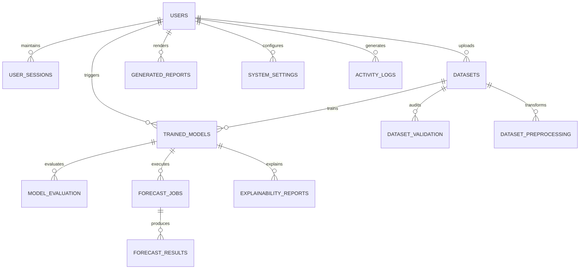

# SmartXSense — Database Schema Architecture Specification
**Adaptive Explainable Hybrid Demand Forecasting Framework for Retail and Electricity Systems**

---

## 1. Database Overview

### 1.1 Purpose
The SmartXSense database serves as the centralized persistent metadata registry and operational store for the hybrid forecasting platform. It manages user credentials, session security, dataset metadata, validation & preprocessing auditing logs, model registry metadata, out-of-sample evaluation metrics, prediction job queues, SHAP/LIME explainability references, report tracking, and system configuration.

### 1.2 Design Goals
* **Integrity & Consistency**: Enforce strict foreign key constraints and transactional integrity across metadata states.
* **Separation of Concerns**: Store relational metadata and dynamic state flags in SQLite while staging large binary arrays (datasets, pickled models, feature matrices) on the file system.
* **Auditability & Traceability**: Ensure full lineage tracking from raw dataset upload → preprocessing steps → model hyperparameter configuration → prediction outputs → XAI attributions.
* **Low-Latency Indexing**: Optimize read/write speeds for real-time frontend dashboard queries through targeted secondary indexing strategies.

### 1.3 Naming Conventions
* **Table Names**: `snake_case` in plural form (e.g., `users`, `datasets`, `trained_models`).
* **Column Names**: `snake_case` in singular form (e.g., `user_id`, `created_at`, `target_column`).
* **Primary Keys**: Primary key named `id` (INTEGER AUTOINCREMENT) or entity-specific prefixed string ID (e.g., `user_id`).
* **Foreign Keys**: Entity name + `_id` suffix (e.g., `dataset_id`, `model_id`).
* **Timestamps**: Stored in ISO-8601 UTC string format (`YYYY-MM-DDTHH:MM:SSZ`) or Unix Epoch Integer.

### 1.4 Normalization Level
The relational schema adheres strictly to **Third Normal Form (3NF)** to eliminate data redundancy and anomaly risks while isolating JSON/TEXT fields for complex hyperparameter configurations and SHAP attribution vectors.

---

## 2. Entity Relationship Overview

The system consists of 13 core relational entities:

1. **Users**: User identities, authentication attributes, and operational roles.
2. **UserSessions**: Active JWT refresh tokens and session metadata.
3. **Datasets**: Uploaded raw datasets metadata, file paths, and dataset dimensions.
4. **DatasetValidation**: Schema validation logs, missing value audits, and quality scores.
5. **DatasetPreprocessing**: Preprocessing parameters, scaling strategies, and feature engineering lineage.
6. **TrainedModels**: AI model registry storing algorithm types, training parameters, and binary paths.
7. **ModelEvaluation**: Out-of-sample backtesting metrics (MAE, RMSE, MAPE, WAPE, R²).
8. **ForecastJobs**: Background prediction execution job tracking and status lifecycle.
9. **ForecastResults**: Time-series forecast outputs, confidence intervals, and actual vs predicted values.
10. **ExplainabilityReports**: SHAP waterfall and LIME local explanation attribution payloads.
11. **GeneratedReports**: Executive analytical report export records (PDF/CSV).
12. **SystemSettings**: User and platform configuration settings.
13. **ActivityLogs**: System audit trail logging security and operational events.

---

## 3. SQLite Table Definitions

### 3.1 Table: `users`
Stores system user profiles, role-based access control flags, and credentials.

| Column | Type | PK | FK | Nullable | Default | Description |
| :--- | :--- | :---: | :---: | :---: | :--- | :--- |
| `user_id` | TEXT | Yes | No | No | `(UUID)` | Unique user identifier string |
| `email` | TEXT | No | No | No | None | Unique user email address |
| `password_hash` | TEXT | No | No | No | None | Argon2 / bcrypt hashed password string |
| `full_name` | TEXT | No | No | No | None | Full display name of the user |
| `role` | TEXT | No | No | No | `'analyst'` | Operational role (`admin`, `analyst`, `viewer`) |
| `is_active` | INTEGER | No | No | No | `1` | Account status flag (`1` = active, `0` = disabled) |
| `created_at` | TEXT | No | No | No | `CURRENT_TIMESTAMP` | Account creation UTC timestamp |
| `updated_at` | TEXT | No | No | No | `CURRENT_TIMESTAMP` | Last profile modification timestamp |

---

### 3.2 Table: `user_sessions`
Tracks active user authentication sessions and JWT refresh token revocation status.

| Column | Type | PK | FK | Nullable | Default | Description |
| :--- | :--- | :---: | :---: | :---: | :--- | :--- |
| `session_id` | TEXT | Yes | No | No | `(UUID)` | Unique session identifier |
| `user_id` | TEXT | No | Yes | No | None | References `users(user_id)` |
| `refresh_token` | TEXT | No | No | No | None | Hashed JWT refresh token payload |
| `ip_address` | TEXT | No | No | Yes | NULL | Client IP address |
| `user_agent` | TEXT | No | No | Yes | NULL | Client browser/device user agent string |
| `is_revoked` | INTEGER | No | No | No | `0` | Token revocation status flag |
| `expires_at` | TEXT | No | No | No | None | Refresh token expiration timestamp |
| `created_at` | TEXT | No | No | No | `CURRENT_TIMESTAMP` | Session initialization timestamp |

---

### 3.3 Table: `datasets`
Stores metadata and disk references for raw uploaded time-series datasets.

| Column | Type | PK | FK | Nullable | Default | Description |
| :--- | :--- | :---: | :---: | :---: | :--- | :--- |
| `dataset_id` | TEXT | Yes | No | No | `(UUID)` | Unique dataset identifier |
| `user_id` | TEXT | No | Yes | No | None | References `users(user_id)` |
| `filename` | TEXT | No | No | No | None | Original uploaded file name |
| `domain` | TEXT | No | No | No | None | Business domain (`retail`, `electricity`) |
| `file_path` | TEXT | No | No | No | None | Absolute path to raw file on disk |
| `file_size_bytes` | INTEGER | No | No | No | None | File size in bytes |
| `row_count` | INTEGER | No | No | Yes | NULL | Total number of data rows |
| `column_count` | INTEGER | No | No | Yes | NULL | Total number of dataset columns |
| `status` | TEXT | No | No | No | `'uploaded'` | Lifecycle status (`uploaded`, `validated`, `processed`) |
| `created_at` | TEXT | No | No | No | `CURRENT_TIMESTAMP` | Upload timestamp |

---

### 3.4 Table: `dataset_validation`
Records automated data quality checks, schema compliance, and missing value audits.

| Column | Type | PK | FK | Nullable | Default | Description |
| :--- | :--- | :---: | :---: | :---: | :--- | :--- |
| `validation_id` | TEXT | Yes | No | No | `(UUID)` | Unique validation record ID |
| `dataset_id` | TEXT | No | Yes | No | None | References `datasets(dataset_id)` |
| `is_valid` | INTEGER | No | No | No | None | Schema compliance flag (`1` = valid, `0` = invalid) |
| `missing_row_count` | INTEGER | No | No | No | `0` | Total missing cells identified |
| `duplicate_row_count`| INTEGER | No | No | No | `0` | Total duplicate rows identified |
| `schema_issues_json` | TEXT | No | No | Yes | NULL | JSON string detailing column type mismatches |
| `validated_at` | TEXT | No | No | No | `CURRENT_TIMESTAMP` | Audit completion timestamp |

---

### 3.5 Table: `dataset_preprocessing`
Tracks preprocessing operations, transformation parameters, and feature engineering lineage.

| Column | Type | PK | FK | Nullable | Default | Description |
| :--- | :--- | :---: | :---: | :---: | :--- | :--- |
| `preprocessing_id` | TEXT | Yes | No | No | `(UUID)` | Unique preprocessing record ID |
| `dataset_id` | TEXT | No | Yes | No | None | References `datasets(dataset_id)` |
| `imputation_strategy`| TEXT | No | No | No | `'linear'` | Strategy used (`linear`, `mean`, `knn`) |
| `scaler_type` | TEXT | No | No | No | `'standard'` | Scaling type (`standard`, `minmax`, `robust`) |
| `lags_generated_json`| TEXT | No | No | Yes | NULL | JSON list of lag interval numbers |
| `processed_file_path`| TEXT | No | No | No | None | Disk path to cleaned `.parquet` file |
| `processed_at` | TEXT | No | No | No | `CURRENT_TIMESTAMP` | Processing completion timestamp |

---

### 3.6 Table: `trained_models`
Registry for all statistical, machine learning, and deep learning model artifacts.

| Column | Type | PK | FK | Nullable | Default | Description |
| :--- | :--- | :---: | :---: | :---: | :--- | :--- |
| `model_id` | TEXT | Yes | No | No | `(UUID)` | Unique model identifier |
| `dataset_id` | TEXT | No | Yes | No | None | References `datasets(dataset_id)` |
| `user_id` | TEXT | No | Yes | No | None | References `users(user_id)` |
| `algorithm` | TEXT | No | No | No | None | Algorithm name (`ARIMA`, `XGBoost`, `LSTM`, `Hybrid`) |
| `domain` | TEXT | No | No | No | None | Target domain (`retail`, `electricity`) |
| `hyperparameters_json`| TEXT | No | No | Yes | NULL | JSON dictionary of hyperparameter values |
| `artifact_path` | TEXT | No | No | No | None | Disk path to serialized model (`.pkl` / `.h5`) |
| `is_active` | INTEGER | No | No | No | `1` | Production deployment status flag |
| `created_at` | TEXT | No | No | No | `CURRENT_TIMESTAMP` | Training completion timestamp |

---

### 3.7 Table: `model_evaluation`
Stores cross-validation performance metrics and backtesting results for each model.

| Column | Type | PK | FK | Nullable | Default | Description |
| :--- | :--- | :---: | :---: | :---: | :--- | :--- |
| `eval_id` | TEXT | Yes | No | No | `(UUID)` | Unique evaluation record ID |
| `model_id` | TEXT | No | Yes | No | None | References `trained_models(model_id)` |
| `mae` | REAL | No | No | No | None | Mean Absolute Error |
| `rmse` | REAL | No | No | No | None | Root Mean Squared Error |
| `mape` | REAL | No | No | No | None | Mean Absolute Percentage Error (%) |
| `wape` | REAL | No | No | Yes | NULL | Weighted Absolute Percentage Error (%) |
| `r2_score` | REAL | No | No | No | None | Coefficient of Determination ($R^2$) |
| `evaluated_at` | TEXT | No | No | No | `CURRENT_TIMESTAMP` | Evaluation execution timestamp |

---

### 3.8 Table: `forecast_jobs`
Manages async forecasting execution tasks and lifecycle statuses.

| Column | Type | PK | FK | Nullable | Default | Description |
| :--- | :--- | :---: | :---: | :---: | :--- | :--- |
| `job_id` | TEXT | Yes | No | No | `(UUID)` | Unique prediction job ID |
| `model_id` | TEXT | No | Yes | No | None | References `trained_models(model_id)` |
| `user_id` | TEXT | No | Yes | No | None | References `users(user_id)` |
| `horizon` | INTEGER | No | No | No | None | Forecast steps/days/hours into future |
| `status` | TEXT | No | No | No | `'pending'` | Lifecycle state (`pending`, `running`, `completed`, `failed`) |
| `error_message` | TEXT | No | No | Yes | NULL | Error description if job failed |
| `started_at` | TEXT | No | No | Yes | NULL | Execution start timestamp |
| `completed_at` | TEXT | No | No | Yes | NULL | Execution completion timestamp |

---

### 3.9 Table: `forecast_results`
Stores point predictions, lower/upper confidence bounds, and historical actual comparisons.

| Column | Type | PK | FK | Nullable | Default | Description |
| :--- | :--- | :---: | :---: | :---: | :--- | :--- |
| `result_id` | INTEGER | Yes | No | No | Auto | Primary key auto-increment ID |
| `job_id` | TEXT | No | Yes | No | None | References `forecast_jobs(job_id)` |
| `timestamp` | TEXT | No | No | No | None | Time-series prediction date/time |
| `actual_value` | REAL | No | No | Yes | NULL | Ground truth demand value (if available) |
| `predicted_value`| REAL | No | No | No | None | Model point forecast output |
| `lower_ci` | REAL | No | No | Yes | NULL | Lower confidence bound (e.g. 95%) |
| `upper_ci` | REAL | No | No | Yes | NULL | Upper confidence bound (e.g. 95%) |

---

### 3.10 Table: `explainability_reports`
Stores feature importance values, SHAP waterfall vectors, and LIME rule explanations.

| Column | Type | PK | FK | Nullable | Default | Description |
| :--- | :--- | :---: | :---: | :---: | :--- | :--- |
| `report_id` | TEXT | Yes | No | No | `(UUID)` | Unique XAI report ID |
| `model_id` | TEXT | No | Yes | No | None | References `trained_models(model_id)` |
| `xai_method` | TEXT | No | No | No | None | Method used (`SHAP`, `LIME`) |
| `base_value` | REAL | No | No | Yes | NULL | Baseline expected model value |
| `attributions_json`| TEXT | No | No | No | None | JSON array of feature importance scores |
| `plot_artifact_path`| TEXT | No | No | Yes | NULL | Path to saved summary/waterfall plot image |
| `generated_at` | TEXT | No | No | No | `CURRENT_TIMESTAMP` | Attribution calculation timestamp |

---

### 3.11 Table: `generated_reports`
Tracks executive PDF/CSV analytical reports rendered by users.

| Column | Type | PK | FK | Nullable | Default | Description |
| :--- | :--- | :---: | :---: | :---: | :--- | :--- |
| `report_id` | TEXT | Yes | No | No | `(UUID)` | Unique report export ID |
| `user_id` | TEXT | No | Yes | No | None | References `users(user_id)` |
| `title` | TEXT | No | No | No | None | Report title string |
| `format` | TEXT | No | No | No | `'pdf'` | Export format (`pdf`, `csv`) |
| `file_path` | TEXT | No | No | No | None | Path to generated document on disk |
| `created_at` | TEXT | No | No | No | `CURRENT_TIMESTAMP` | Report creation timestamp |

---

### 3.12 Table: `system_settings`
Stores user settings, dashboard preferences, and retrain thresholds.

| Column | Type | PK | FK | Nullable | Default | Description |
| :--- | :--- | :---: | :---: | :---: | :--- | :--- |
| `setting_id` | INTEGER | Yes | No | No | Auto | Primary key ID |
| `user_id` | TEXT | No | Yes | No | None | References `users(user_id)` |
| `setting_key` | TEXT | No | No | No | None | Key name string (e.g. `confidence_level`) |
| `setting_value` | TEXT | No | No | No | None | Stringified setting value |
| `updated_at` | TEXT | No | No | No | `CURRENT_TIMESTAMP` | Modification timestamp |

---

### 3.13 Table: `activity_logs`
Audit log recording critical platform user actions and system alerts.

| Column | Type | PK | FK | Nullable | Default | Description |
| :--- | :--- | :---: | :---: | :---: | :--- | :--- |
| `log_id` | INTEGER | Yes | No | No | Auto | Primary key ID |
| `user_id` | TEXT | No | Yes | Yes | NULL | References `users(user_id)` |
| `action` | TEXT | No | No | No | None | Event descriptor (e.g. `USER_LOGIN`, `MODEL_TRAINED`) |
| `details` | TEXT | No | No | Yes | NULL | Additional textual context |
| `ip_address` | TEXT | No | No | Yes | NULL | Request originating IP address |
| `created_at` | TEXT | No | No | No | `CURRENT_TIMESTAMP` | Log event timestamp |

---

## 4. Table Relationships Architecture

The relational structure enforces referential integrity across dataset lineage, training runs, forecasts, and XAI artifacts:

```
users
  │
  ├──< user_sessions
  ├──< datasets
  │      │
  │      ├──< dataset_validation
  │      ├──< dataset_preprocessing
  │      └──< trained_models
  │             │
  │             ├──< model_evaluation
  │             ├──< forecast_jobs
  │             │      │
  │             │      └──< forecast_results
  │             │
  │             └──< explainability_reports
  │
  ├──< generated_reports
  ├──< system_settings
  └──< activity_logs
```

### Key Cardinalities
1. **User → Datasets**: One-to-Many ($1 : N$). A user can upload multiple datasets.
2. **Dataset → Preprocessing / Validation**: One-to-Many ($1 : N$). A dataset can undergo multiple validation audits and preprocessing pipeline iterations.
3. **Dataset → Trained Models**: One-to-Many ($1 : N$). Multiple models (ARIMA, XGBoost, LSTM, Hybrid) can be trained on a single dataset.
4. **Trained Model → Evaluation**: One-to-One / One-to-Many ($1 : N$). A model record has corresponding backtest evaluation metrics per fold.
5. **Trained Model → Forecast Jobs**: One-to-Many ($1 : N$). A trained model can execute multiple prediction jobs for different horizons.
6. **Forecast Job → Forecast Results**: One-to-Many ($1 : N$). A forecast job produces $N$ time-series predictions (one per horizon step).
7. **Trained Model → Explainability Reports**: One-to-Many ($1 : N$). A model can have multiple SHAP and LIME attribution reports generated for sample instances.

---

## 5. Entity Relationship (ER) Diagram



---

## 6. Indexing Strategy

To support high-concurrency dashboard queries, real-time forecast retrieval, and audit lookups, the following secondary indexes are defined:

1. **`idx_datasets_user_domain`**
   * **Target Table**: `datasets` (`user_id`, `domain`)
   * **Purpose**: Speeds up filtering datasets on the dataset management page by active domain (`retail` vs `electricity`).

2. **`idx_trained_models_domain_active`**
   * **Target Table**: `trained_models` (`domain`, `is_active`)
   * **Purpose**: Optimizes model selection lookups when retrieving active production models for predictions.

3. **`idx_forecast_results_job_date`**
   * **Target Table**: `forecast_results` (`job_id`, `timestamp`)
   * **Purpose**: Essential for time-series chart rendering; ensures fast range scans when plotting predicted vs actual points on the frontend charts.

4. **`idx_explainability_model_method`**
   * **Target Table**: `explainability_reports` (`model_id`, `xai_method`)
   * **Purpose**: Speeds up retrieval of SHAP summary and LIME feature attributions on the XAI dashboard page.

5. **`idx_activity_logs_user_created`**
   * **Target Table**: `activity_logs` (`user_id`, `created_at`)
   * **Purpose**: Optimizes pagination and sorting when viewing security and system activity logs.

---

## 7. Data Flow Architecture

The step-by-step movement of data across the SQLite database and filesystem storage layers:

```
[User / Frontend]
       │
       │ 1. Upload raw file (.csv / .xlsx)
       ▼
[Datasets API Endpoint] ──(Save File)──► [Disk: ml_engine/data/raw/]
       │
       │ 2. Insert metadata record
       ▼
[SQLite: datasets]
       │
       │ 3. Execute Schema Check & Validation
       ▼
[SQLite: dataset_validation]
       │
       │ 4. Preprocess & Feature Engineering
       ▼
[Disk: ml_engine/data/processed/] ◄─── (Write Clean Parquet)
       │
       │ 5. Train Model Pipeline (ARIMA/XGBoost/LSTM)
       ▼
[Disk: ml_engine/artifacts/models/] ◄── (Save Model Binary .pkl/.h5)
       │
       │ 6. Register Model & Save Evaluation Metrics
       ▼
[SQLite: trained_models & model_evaluation]
       │
       │ 7. Execute Inference & Hybrid Fusion
       ▼
[SQLite: forecast_jobs & forecast_results]
       │
       │ 8. Compute SHAP / LIME Attributions
       ▼
[SQLite: explainability_reports] ──(Save Plots)──► [Disk: storage/exports/]
       │
       │ 9. Export Analytics Report
       ▼
[SQLite: generated_reports] ──(Render PDF)──► [Disk: reports/exports/]
```

---

## 8. Storage Structure Partitioning

SmartXSense employs a hybrid database-filesystem architecture designed for performance and efficiency:

### 8.1 SQLite Database Partitioning
Stored in `storage/smartxsense.db`:
* User credentials, sessions, and permissions.
* Dataset file metadata, dimensions, and validation logs.
* Preprocessing parameters and feature engineering settings.
* Model registry details, hyperparameters, and evaluation scores (MAE/RMSE/MAPE).
* Forecast job states, historical prediction points, and confidence intervals.
* XAI text attributions, SHAP vector JSONs, and LIME rule weights.
* Application settings and activity audit logs.

### 8.2 Disk File Storage Partitioning
Organized under project storage folders:
* **`ml_engine/data/raw/`**: Raw CSV/XLSX uploaded datasets.
* **`ml_engine/data/processed/`**: Cleaned, imputed, and scaled `.parquet` feature matrices.
* **`ml_engine/artifacts/models/`**: Serialized model binaries (`.pkl`, `.joblib`, `.h5`).
* **`ml_engine/artifacts/scalers/`**: Saved feature scaling objects (`StandardScaler`, `MinMaxScaler`).
* **`storage/uploads/`**: Staging area for user file imports.
* **`storage/exports/`**: Rendered SHAP/LIME visualization plots (`.png`, `.svg`).
* **`reports/exports/`**: Exported PDF and CSV executive reports.

---

## 9. Future Scalability & Migration Strategy

Although SQLite is optimal for local execution and research prototyping, the database schema is structured for seamless migration to enterprise relational databases like **PostgreSQL** or **MySQL**:

1. **Standard ANSI SQL Types**: Data types (`TEXT`, `INTEGER`, `REAL`) map directly to PostgreSQL `VARCHAR`/`TEXT`, `INTEGER`/`BIGINT`, and `DOUBLE PRECISION`/`FLOAT`.
2. **UUID Support**: `UUID` string primary keys (`user_id`, `dataset_id`, `model_id`) allow native migration to PostgreSQL `uuid` or MySQL `binary(16)` without sequence collision risks.
3. **ISO-8601 Timestamps**: Text-based UTC timestamps map cleanly to PostgreSQL `TIMESTAMPTZ`.
4. **JSON Field Abstraction**: SQLite `TEXT` JSON fields can be directly upgraded to native PostgreSQL `jsonb` or MySQL `JSON` types for indexing within JSON attributions.
5. **ORM Independence**: Database access interfaces abstract raw SQL syntax, allowing backend database driver updates via simple configuration change in `backend/app/config.py`.
